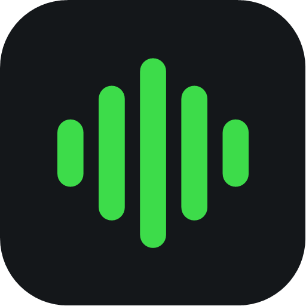

# GameDub

Автоматичний переклад англійських і російських субтитрів в іграх українською — з озвучкою.
Зроблено для портативної приставки **ASUS ROG Xbox Ally X** (Windows 11), але працює на будь-якому ПК з Windows 10/11.

Розпізнає субтитри на екрані (вбудований OCR Windows) → перекладає українською → озвучує окремими голосами для персонажів.
Працює з інтернетом і без нього. Керується геймпадом, інтерфейс у стилі Xbox.

## Як це працює

| Крок | З інтернетом | Без інтернету |
|---|---|---|
| Субтитри | Windows.Media.Ocr | те саме |
| Переклад | Google / Bing / MyMemory (безкоштовно), за бажанням LLM | офлайн-моделі Helsinki-NLP: opus-mt-tc-big (en→uk), opus-mt (ru→uk) |
| Голос | ElevenLabs → Google HD → OpenAI (за наявності ключів) | Supertonic 3 (офлайн) → Edge |

Перемикання автоматичне. Служба в треї сама вмикає переклад, коли запускається гра з галочкою, і вимикає, коли гра закривається.

## Встановлення

1. Потрібен **.NET 8 Desktop Runtime**.
2. Склонуй репозиторій у `C:\GameDub`.
3. Збери програму: `src\tools\build.ps1` (сам завантажить .NET SDK у `C:\GameDub\_build`; після збирання цю папку можна видалити).
4. (Необов'язково) офлайн-моделі: `src\tools\get-models.ps1` (~870 МБ у `C:\GameDub\models`; YAMNet потрібна для спалахів підсвітки).
5. (Для російських субтитрів) пакет розпізнавання Windows, від адміністратора: `Add-WindowsCapability -Online -Name 'Language.OCR~~~ru-RU~0.0.1.0'`.
6. Запусти `C:\GameDub\app\GameDub.exe`.

Ключі API **не потрібні** — усе працює безкоштовно. Ключі ElevenLabs / Google / OpenAI можна додати в налаштуваннях для живіших голосів; вони зберігаються лише локально в `data\config.json`.

## Як користуватися

1. Відкрий GameDub, на плитці гри натисни **A** — з'явиться зелена галочка.
2. Якщо субтитри в грі російські, натисни на плитці **X** — з'явиться мітка «RU → UA».
3. Запусти гру: субтитри **увімкнені**, режим екрана — **Borderless / Без рамки**.
4. Далі все автоматично: перший раз програма за кілька секунд сама знаходить область субтитрів.

**Керування:** A — увімк./вимк. гру · X — мова субтитрів (на плитці гри) або вставити з буфера (у полі ключа) · Y — скинути область · LB/RB — Ігри/Налаштування · B — назад.

**Гарячі клавіші в грі:**
- `Pause` (або `Ctrl+Alt+P`) — пауза перекладу
- `Scroll Lock` (або `Ctrl+Alt+R`) — редактор області субтитрів (D-pad рух/ширина, LB/RB висота, Y автопошук, A зберегти, B скасувати)

**Задні кнопки M1/M2 (Armoury Crate SE):** Налаштування → Режим керування → Налаштувати → Режим геймпада → M1 → зняти «Set as Secondary Function» → Клавіатура → `Pause`. Для M2 — `Scroll Lock`.

## Налаштування

- **Голоси «Авто»:** найкращий доступний сервіс; при вичерпанні ліміту чи помилці — наступний.
- **Supertonic:** оповідач M1, персонажі M2/M3/M5 і F1–F5; кожному персонажу голос закріплюється назавжди. `SupertonicSteps` у `data\config.json` — якість/швидкість (5).
- **Наздоганяння діалогу:** якщо озвучка відстає, темп росте до +20 %, репліки старші за 8 с пропускаються.

## Підсвітка стіків

Служба GameDub (у треї) керує світлом стіків через **Windows Dynamic Lighting**. Потрібен **автозапуск служби**.

Windows дає керувати світлом у фоні лише програмам із «пакетом». Тому один раз після кожної нової збірки (від адміністратора): `src\tools\install-package.ps1`. Він реєструє пакет GameDub (програма лишається в `C:\GameDub\app`). Потім: Параметри → Персоналізація → Динамічне освітлення → Фонове керування світлом → **GameDub**. Пакет і сертифікат дає збірка на GitHub (`.github/workflows/build.yml`).

- **Спокій:** ледь світиться кольором акценту Windows (яскравість — у налаштуваннях).
- **Звукові ефекти:** короткий спалах на вибух, постріл, удар, розбите скло; червоно-сині вогні на сирену чи тривогу; жовтий — на гудок. На голоси й музику не реагує. Звук береться з того, що грає Windows, тож працює і в навушниках. Модель YAMNet (~16 МБ, `get-models.ps1`), один потік процесора.
- **Вібрація на вибухи й удари** (вимкнена, вмикається в налаштуваннях): коротка вібрація від тих самих звукових ефектів — для ігор, які самі не вібрують.
- **Завантаження гри:** синє «дихання», поки качається; зелене, коли скачалось (до першого дотику).
- **Мало заряду / зарядка, перегрів:** вимкнені, вмикаються в налаштуваннях.
- **Ігри зі своїм світлом:** якщо гра сама керує світлом через Dynamic Lighting, Windows віддає світло їй. Ігри зі списку «Ігри зі своїм світлом» (за замовчуванням Euro Truck Simulator 2 і American Truck Simulator) GameDub не чіпає.
- **Екран вимкнений:** світло вимкнене (крім завантаження).

Перевірка: `GameDub.exe --test lights` (кольори по черзі) і `--test soundfx 60` (що почуто за хвилину), результат у `data\test-out.txt`.

## Файли

- `src\` — вихідний код (C#, .NET 8, WPF + WinForms, ONNX Runtime)
- `app\` — зібрана програма (не в репозиторії)
- `data\` — налаштування, ключі, профілі ігор (не в репозиторії)
- `models\` — офлайн-моделі (не в репозиторії, `get-models.ps1`)

**Видалення:** Налаштування → «Автозапуск» → Вимкнено, у треї → «Вийти зі служби», потім видали `C:\GameDub`.

## Ліцензія

**LGPL-3.0** — див. [COPYING.LESSER](COPYING.LESSER) і [COPYING](COPYING).

Сторонні компоненти:
- `src/GameDub/Pipeline/EdgeDrm.cs` — порт коду з [rany2/edge-tts](https://github.com/rany2/edge-tts) (LGPL-3.0).
- `src/GameDub/Pipeline/Supertonic.cs` — на основі прикладу [supertone-inc/supertonic](https://github.com/supertone-inc/supertonic) (MIT).
- Моделі (завантажуються окремо): [Supertonic 3](https://huggingface.co/Supertone/supertonic-3) — OpenRAIL-M; [opus-mt-tc-big-en-zle](https://huggingface.co/Helsinki-NLP/opus-mt-tc-big-en-zle) і [opus-mt-ru-uk](https://huggingface.co/Helsinki-NLP/opus-mt-ru-uk) — CC-BY 4.0.
- [ONNX Runtime](https://github.com/microsoft/onnxruntime) — MIT.

Програма використовує неофіційні безкоштовні сервіси (Microsoft Edge Read Aloud, Google Translate, Bing Translator), які можуть змінитися без попередження.
